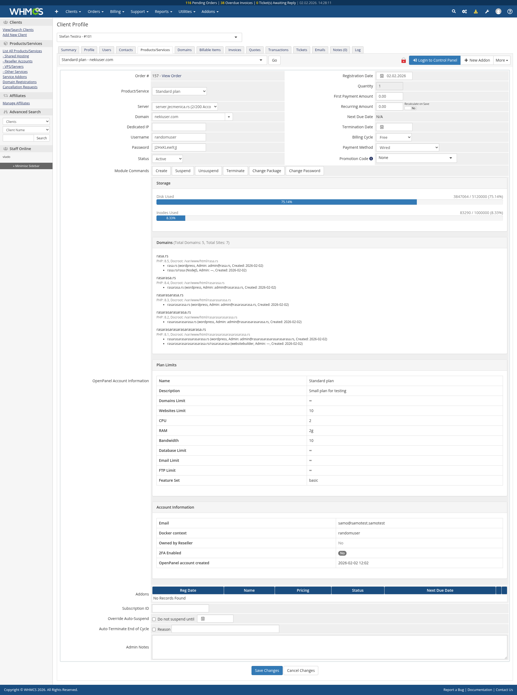

# OpenPanel WHMCS Module

WHMCS provisioning module for [OpenPanel](https://openpanel.com). It creates and manages OpenPanel hosting accounts and OpenAdmin reseller accounts from WHMCS orders, invoices and payments.



## Requirements

- WHMCS 9.0 or later, on PHP 8.2 or 8.3
- An OpenPanel Enterprise server with the OpenAdmin API enabled (**OpenAdmin > Settings > API Access**)
- From the WHMCS server, access to OpenAdmin's port (2087 by default)
- For reseller products: OpenPanel 2.0.23 or later, with resellers turned on in OpenAdmin

## Installation

1. On the WHMCS server, clone the repository into WHMCS as `modules/servers/openpanel`:
   ```bash
   git clone https://github.com/stefanpejcic/openpanel-whmcs-module.git path_to_whmcs/modules/servers/openpanel
   ```
   The folder must be named `openpanel`, because every function is prefixed with `openpanel_`. Cloning it there also lets you update with `git pull` (see [Updating](#updating)).
2. In WHMCS go to **System Settings > Servers > Add New Server**, then:
   - **Module:** OpenPanel
   - **Hostname or IP:** the OpenAdmin hostname or IP, the same one its SSL certificate is issued for. A hostname is always reached over `https://`. A bare IP is reached over `https://` when **Use SSL Mode for Connections** is ticked (the WHMCS default), and over plain `http://` when it is not. OpenAdmin serves HTTPS on its IP once Caddy has a certificate for it (Let's Encrypt issues IP certificates), so untick the box only if `https://<ip>:2087` doesn't load.
   - **Username / Password:** an OpenAdmin administrator
   - **Port:** 2087, unless you changed it
   - Click **Test Connection**.
3. Put the server in a server group. On each product, open **Module Settings**, pick that group, and choose the **OpenPanel Plan**. WHMCS loads the dropdown from the server. For reseller products see [Selling reseller accounts](#selling-reseller-accounts).

```
modules/servers/openpanel/
├── openpanel.php                 module functions
├── lib/ApiClient.php             OpenAdmin API client (token cache, logging)
├── lib/ApiException.php
├── templates/clientarea.tpl      client area login button
├── templates/admin_services_tab.php            admin service panel, hosting accounts
├── templates/admin_services_tab_reseller.php   admin service panel, reseller accounts
└── whmcs.json
```

## Supported operations

| Where | What |
|---|---|
| Server page | Test Connection, and **Log in to OpenAdmin** (single sign-on as the server admin) |
| Product | Plan and reseller package dropdowns loaded from the server |
| Service, admin area | Create (user and domain), Suspend, Unsuspend, Terminate, Change Package, Change Password, **Log in to OpenPanel**, and an account panel showing storage, domains, sites, plan limits and status |
| Service, client area | **Log in to OpenPanel**, Change Password |
| Daily cron | Disk usage import into WHMCS (`diskusage`/`disklimit`, in MB) |
| Reseller products | See [Selling reseller accounts](#selling-reseller-accounts) |

## Selling reseller accounts

The same module provisions OpenAdmin resellers. Resellers need OpenPanel Enterprise 2.0.23 or later, and must be turned on in OpenAdmin under **Accounts > Resellers**. The server in WHMCS must use an OpenAdmin administrator login.

1. In OpenAdmin, create reseller packages under **Hosting plans > Reseller packages**. A package sets the maximum number of accounts, disk space, and which user plans the reseller can use.
2. In WHMCS, create a product with **Product Type: Reseller Account**. On **Module Settings**, pick the server group and choose the **Reseller Package**. **OpenPanel Plan** is not used for reseller products.
3. Tick **Delete reseller's accounts on terminate** if terminating the service should also delete every account the reseller created. When it's unticked, those accounts move to the OpenAdmin administrator and keep running.

| WHMCS action | OpenAdmin |
|---|---|
| Create | Creates the reseller on the chosen package. Usernames must be 5-30 characters (letters, numbers, `_`), passwords 6-30 characters without spaces. |
| Suspend | Suspends the reseller and every active account they own. |
| Unsuspend | Unsuspends the reseller and only the accounts suspended along with them, so accounts the reseller suspended themselves stay suspended. |
| Terminate | Deletes the reseller. Their accounts move to the administrator, or are deleted when the product option is ticked. |
| Change Package | Moves the reseller to the product's package. OpenAdmin refuses a downgrade below what the reseller already uses. |
| Change Password | Changes the reseller's OpenAdmin password. |
| Log in | Opens OpenAdmin logged in as the reseller, also for clients in the client area. |
| Daily cron | Imports the reseller's total disk usage and limit. |

The admin service page shows the reseller's package, account and disk usage, and status.

### Resellers selling with their own WHMCS

A reseller can install this module in their own WHMCS and add the server with **their own** OpenAdmin username and password, then sell hosting accounts (not reseller accounts) to their customers. Accounts they create there are owned by them and count against their package, the plan dropdown only lists the plans assigned to them, and the daily usage import only returns their accounts (OpenPanel 2.0.23 or later). If the reseller is suspended, their WHMCS can't reach OpenAdmin until they're unsuspended.

## Upgrading from v1

1. Move the old `path_to_whmcs/modules/servers/openpanel` folder out of `modules/servers` (keep it as a backup), then install this version as in step 1 of [Installation](#installation).
2. **Check each product's plan.** v1 showed a Plan dropdown but ignored it, and always used the OpenPanel plan named exactly like the WHMCS product. This version uses the dropdown:
   - If the field is empty, it falls back to the plan named after the product, as v1 did.
   - If the field holds a number (v1 saved plan IDs there), it is matched to the plan with that ID.
   - To be safe, open each OpenPanel product, pick the plan and save.
3. The per-page-load login links (`LoginLink`, `AdminLink`) are replaced by WHMCS's single sign-on buttons. Login links are now created only when someone clicks.
4. The `OPENPANEL_DEBUG` constant is gone. Use the WHMCS module log instead (below). Passwords and tokens are masked in it.

## Updating

```bash
cd path_to_whmcs/modules/servers/openpanel/ && git pull
```

## Troubleshooting

In WHMCS:

1. Turn on [module logging](https://developers.whmcs.com/provisioning-modules/module-logging/).
2. Repeat the action.
3. Check `YOUR_WHMCS_ADMIN_URI/index.php?rp=/admin/logs/module-log`. Each OpenAdmin request is logged with its HTTP status.

Failed client-area logins are written to the WHMCS activity log. The client only sees a generic message.

On the OpenPanel server, enable [`DEV_MODE`](https://dev.openpanel.com/cli/config.html#dev-mode) and read `/var/log/openpanel/admin/api.log`.

Common errors:

- **OpenAdmin is rate-limiting logins.** OpenAdmin allows 5 logins per IP, then `login_ratelimit` per minute (default 5), and the OpenAdmin login form shares that limit. This module reuses one token for up to 10 minutes, so you should only see this if something else is logging in from the WHMCS server's IP.
- **SSL: no alternative certificate subject name matches target hostname.** The **Hostname or IP** set on the server in WHMCS isn't the one OpenAdmin's certificate is for. Run `opencli admin` on the server to see the address OpenAdmin uses, and enter that.
- **Resellers are disabled.** Turn resellers on in OpenAdmin under **Accounts > Resellers** before creating reseller products.
- **Reseller usernames must be 5-30 characters.** OpenAdmin's username rules differ from OpenPanel's. Change the service username in WHMCS and run Create again.
- **An error with no reason.** OpenPanel versions before 2.0.23 don't always pass the `opencli` error back through the API. Run the same `opencli` command on the server to see the reason.
